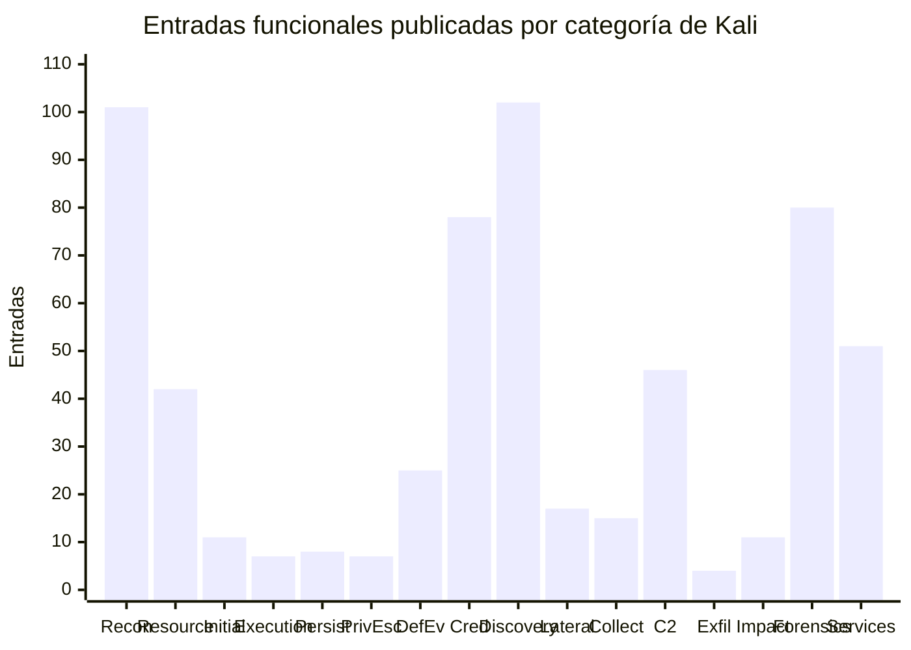

# Catálogo de herramientas de Kali Linux

- **Fuente** — Deep research de Gemini, verificado contra páginas oficiales kali.org según el informe.
- **Fecha** — 2026-11-26
- **Mantiene** — referencia

> **Alcance.** Este catálogo es metodología de referencia. La autorización se limita a los objetivos incluidos en un `ctf/SCOPE.md` o en un `ctf/targets/<objetivo>/SCOPE.md` confirmado. El catálogo describe la finalidad de cada herramienta y excluye comandos de explotación. Consulta el [playbook CTF](../../ctf/PLAYBOOK.md).

## Índice de categorías

- [Reconnaissance](#reconnaissance)
- [Resource Development](#resource-development)
- [Initial Access](#initial-access)
- [Execution](#execution)
- [Persistence](#persistence)
- [Privilege Escalation](#privilege-escalation)
- [Defense Evasion](#defense-evasion)
- [Credential Access](#credential-access)
- [Discovery](#discovery)
- [Lateral Movement](#lateral-movement)
- [Collection](#collection)
- [Command and Control](#command-and-control)
- [Exfiltration](#exfiltration)
- [Impact](#impact)
- [Forensics](#forensics)
- [Services and Other Tools](#services-and-other-tools)

[Mapa a las fichas de análisis](#mapa-a-las-fichas-de-análisis)

## Resumen ejecutivo

Sí: el alcance debe ser **todas**, no una selección de las herramientas más conocidas. El catálogo oficial que señalaste, **All Kali Tools**, no es simplemente una lista plana de aplicaciones: Kali distingue explícitamente tres tipos de entrada —**Source**, **Package** y **Command**— y la misma aplicación puede generar varios paquetes y muchos ejecutables. Por ejemplo, `aircrack-ng` aparece como fuente/paquete y debajo expone numerosos comandos; `john` incorpora además decenas de conversores `*2john`; `llvm-defaults` incluye una familia muy amplia de utilidades de compilación. Por eso contar cada línea como si fuera una herramienta independiente inflaría artificialmente el inventario.

Para la investigación, la unidad que debe resumirse como **herramienta** será cada entrada de herramienta o componente que Kali publica en su taxonomía funcional, conservando los comandos que el propio sitio eleva a herramienta categorizada —por ejemplo `gvm-start`, `impacket-psexec`, `affcat`, `nfc-list` o `hackrf_info`—, pero sin convertir automáticamente cada dependencia, biblioteca de desarrollo o alias interno en una herramienta independiente. La página oficial de categorías es la que Kali utiliza para asignar las herramientas a fases y funciones como Reconnaissance, Credential Access, Discovery, Forensics o Command and Control.

La comprobación realizada el **26 de noviembre de 2026** muestra además que el índice de categorías y el estado real de los paquetes no siempre coinciden perfectamente: hay nombres que todavía aparecen en la taxonomía pero que Kali documenta como retirados. Por ejemplo, `backdoor-factory` fue eliminado por estar sin mantenimiento y roto; `hydra-gtk` fue retirado por su dependencia de GTK 2; `mfcuk`, `mfoc` y `mfterm` fueron retirados en 2026 por dependencias antiguas de USB; y `yersinia` fue retirado en noviembre de 2025 por falta de mantenimiento.

## Qué significa «todas» en este informe

El índice **All Kali Tools** contiene miles de registros si se cuentan por separado fuentes, paquetes binarios, bibliotecas y ejecutables. La leyenda oficial deja clara esa jerarquía. Así, `afflib` incluye `afflib-tools`, bibliotecas y comandos como `affcat`, `affcompare`, `affcopy` o `affverify`; `curl` incluye el paquete, bibliotecas y los ejecutables `curl`, `wcurl` y `curl-config`; y `glibc` incluye docenas de paquetes de arquitectura que no son utilidades de seguridad distintas.

Por tanto, para evitar dos errores opuestos —**omitir herramientas reales** o **contar dependencias como herramientas**— la cobertura correcta es:

| Elemento del sitio | ¿Se incluye como herramienta independiente? | Criterio |
|---|---:|---|
| Herramienta/fuente principal | Sí | Es la unidad principal del catálogo |
| Comando que Kali categoriza explícitamente | Sí | Kali lo trata como utilidad funcional |
| Paquete binario con función propia | Sí, cuando procede | Ej. cliente, servidor o GUI diferenciada |
| Alias del mismo ejecutable | No se duplica | Se documenta bajo la herramienta principal |
| Biblioteca `lib*`, `*-dev`, documentación | No | Es soporte técnico, no utilidad autónoma |
| Metapaquete | Solo cuando tiene función administrativa propia | No se confunde con las herramientas que instala |
| Herramienta retirada | Sí | Se conserva para cobertura histórica y se marca **obsoleta/retirada** |
| Entrada sin documentación comprobable | Sí | Se marca **no verificable** |

Esta decisión es necesaria porque, por ejemplo, la página `all-tools` muestra bajo `openssl` varios paquetes de bibliotecas además del binario `openssl`, y bajo `openssh` aparecen cliente, servidor, componentes comunes y numerosos ejecutables; tratarlos todos como herramientas de ciberseguridad independientes sería incorrecto.

## Estructura oficial y volumen

La página actual de categorías organiza las utilidades en dieciséis grandes áreas: **Reconnaissance, Resource Development, Initial Access, Execution, Persistence, Privilege Escalation, Defense Evasion, Credential Access, Discovery, Lateral Movement, Collection, Command and Control, Exfiltration, Impact, Forensics y Services and Other Tools**. Dentro de algunas existen subcategorías como Web Scanning, Bluetooth, WiFi, Password Cracking, Active Directory, VoIP, Sleuth Kit Suite o Reporting Tools.

```mermaid
flowchart TD
    K["Kali Linux Tools"]
    K --> R["Reconnaissance"]
    K --> RD["Resource Development"]
    K --> IA["Initial Access"]
    K --> EX["Execution"]
    K --> P["Persistence"]
    K --> PE["Privilege Escalation"]
    K --> DE["Defense Evasion"]
    K --> CA["Credential Access"]
    K --> D["Discovery"]
    K --> LM["Lateral Movement"]
    K --> C["Collection"]
    K --> CC["Command and Control"]
    K --> EF["Exfiltration"]
    K --> I["Impact"]
    K --> F["Forensics"]
    K --> S["Services and Other Tools"]

    R --> R1["Host / Identity / Network / DNS"]
    R --> R2["Web / Vulnerability / Bluetooth / WiFi / RF"]
    CA --> CA1["Hashes / Wordlists / Brute Force / Passwords"]
    CA --> CA2["WiFi / NFC / Kerberos / VoIP"]
    D --> D1["Network / SSL / SNMP / Sniffing"]
    D --> D2["AD / Shares / Databases / VoIP / Cisco"]
    F --> F1["Digital Forensics / Carving / Imaging"]
    F --> F2["PDF / Sleuth Kit"]
    CC --> CC1["Application / Non-Application protocols"]
    CC --> CC2["Protocol Tunneling"]
```

Contando **entradas funcionales tal como aparecen dentro de las categorías**, incluidas las repeticiones cuando Kali coloca una utilidad en más de una función, la página contiene aproximadamente las siguientes entradas categorizadas. Las repeticiones son deliberadas: por ejemplo, `nmap`, `netexec` o `metasploit-framework` aparecen en más de una fase porque cumplen varios papeles.

## Inventario funcional de las herramientas

Las tablas conservan las agrupaciones del informe. Las categorías con una tabla compartida enlazan a ese bloque. Algunas tablas carecen de URLs individuales en la fuente. Consulta el [índice oficial de categorías de Kali](https://www.kali.org/tools/) y el [índice de herramientas de Kali](https://www.kali.org/tools/all-tools/).

La tabla siguiente conserva la nomenclatura exacta publicada por Kali y resume la finalidad sin proporcionar instrucciones, comandos de explotación ni procedimientos operativos. Las referencias corresponden al catálogo oficial de Kali consultado el **2026-11-26**; cuando una herramienta consta oficialmente como retirada, se indica expresamente. La página de categorías es la fuente primaria para la asignación funcional.

## Reconnaissance

| Nombre | Finalidad | Usos legítimos | Referencia oficial | Estado |
|---|---|---|---|---|
| amass | Descubrimiento de activos y subdominios | Inventario de superficie externa | `https://www.kali.org/tools/amass/` | Activo |
| apache-users | Enumeración de usuarios expuestos por servidores Apache | Auditorías de configuración | `https://www.kali.org/tools/apache-users/` | Activo |
| arjun | Descubrimiento de parámetros HTTP | Pruebas de aplicaciones propias | `https://www.kali.org/tools/arjun/` | Activo |
| assetfinder | Descubrimiento de dominios y subdominios relacionados | Inventario de activos | `https://www.kali.org/tools/assetfinder/` | Activo |
| autorecon | Automatización de reconocimiento de servicios | Pentesting autorizado | `https://www.kali.org/tools/autorecon/` | Activo |
| bettercap | Análisis y monitorización de redes locales e inalámbricas | Diagnóstico y laboratorios | `https://www.kali.org/tools/bettercap/` | Activo |
| bluelog | Registro y descubrimiento de dispositivos Bluetooth | Auditoría RF/Bluetooth | `https://www.kali.org/tools/bluelog/` | Activo |
| blueranger | Estimación/prospección de dispositivos Bluetooth | Evaluaciones inalámbricas autorizadas | `https://www.kali.org/tools/blueranger/` | Activo |
| bluesnarfer | Evaluación de servicios Bluetooth heredados | Auditorías de dispositivos propios | `https://www.kali.org/tools/bluesnarfer/` | Activo |
| btscanner | Exploración de dispositivos Bluetooth | Inventario inalámbrico | `https://www.kali.org/tools/btscanner/` | Activo |
| burpsuite | Proxy y plataforma de evaluación de aplicaciones web | Pruebas web autorizadas | `https://www.kali.org/tools/burpsuite/` | Activo |
| caido | Proxy y plataforma moderna de seguridad web | Auditoría de aplicaciones | `https://www.kali.org/tools/caido/` | Activo |
| caido-cli | Interfaz de línea de comandos de Caido | Automatización de laboratorios y QA | `https://www.kali.org/tools/caido/` | Activo |
| chirp | Programación y gestión de radios compatibles | Administración de equipos de radio | `https://www.kali.org/tools/chirp/` | Activo |
| crlfuzz | Detección de problemas relacionados con CRLF HTTP | QA y seguridad web | `https://www.kali.org/tools/crlfuzz/` | Activo |
| davtest | Comprobación de configuración de WebDAV | Auditoría de servidores propios | `https://www.kali.org/tools/davtest/` | Activo |
| dirb | Descubrimiento de contenido web | Inventario de aplicaciones | `https://www.kali.org/tools/dirb/` | Activo |
| dirbuster | Enumeración gráfica de directorios web | Auditoría web | `https://www.kali.org/tools/dirbuster/` | Activo |
| dirsearch | Descubrimiento de rutas y recursos web | Evaluación de superficie web | `https://www.kali.org/tools/dirsearch/` | Activo |
| dmitry | Recopilación de información de hosts y dominios | OSINT y reconocimiento autorizado | `https://www.kali.org/tools/dmitry/` | Activo |
| dnsenum | Enumeración DNS | Inventario de DNS | `https://www.kali.org/tools/dnsenum/` | Activo |
| dnsmap | Descubrimiento de subdominios DNS | Auditoría de dominios propios | `https://www.kali.org/tools/dnsmap/` | Activo |
| dnsrecon | Enumeración y comprobaciones DNS | Revisión de infraestructura DNS | `https://www.kali.org/tools/dnsrecon/` | Activo |
| dnstracer | Seguimiento de resolución/delegación DNS | Diagnóstico DNS | `https://www.kali.org/tools/dnstracer/` | Activo |
| dnswalk | Comprobación de coherencia de zonas DNS | Administración DNS | `https://www.kali.org/tools/dnswalk/` | Activo |
| email2phonenumber | Correlación OSINT entre correo y numeración telefónica | Investigación autorizada de identidad | `https://www.kali.org/tools/` | Activo |
| emailharvester | Recopilación OSINT de direcciones de correo | Inventario de exposición pública | `https://www.kali.org/tools/` | Activo |
| fang | Utilidad relacionada con descubrimiento Bluetooth | Evaluación de radio autorizada | `https://www.kali.org/tools/` | Activo |
| feroxbuster | Descubrimiento recursivo de contenido HTTP | Pentesting web | `https://www.kali.org/tools/feroxbuster/` | Activo |
| ffuf | Fuzzing y descubrimiento rápido de recursos web | Pruebas de aplicaciones | `https://www.kali.org/tools/ffuf/` | Activo |
| finalrecon | Reconocimiento web automatizado | Evaluación de superficie pública | `https://www.kali.org/tools/finalrecon/` | Activo |
| findomain | Descubrimiento de subdominios | Gestión de superficie de ataque | `https://www.kali.org/tools/findomain/` | Activo |
| gnuradio | Plataforma de procesamiento de radio definida por software | Investigación RF y docencia | `https://www.kali.org/tools/gnuradio/` | Activo |
| gobuster | Enumeración de directorios, DNS y otros recursos | Auditoría de activos propios | `https://www.kali.org/tools/gobuster/` | Activo |
| gospider | Rastreador web | Inventario de enlaces y endpoints | `https://www.kali.org/tools/gospider/` | Activo |
| gqrx | Receptor gráfico SDR | Análisis del espectro autorizado | `https://www.kali.org/tools/gqrx/` | Activo |
| gvm-start | Inicio del entorno Greenbone/OpenVAS | Gestión de escáner de vulnerabilidades | `https://www.kali.org/tools/gvm/` | Activo |
| hackrf_info | Consulta de dispositivos HackRF | Diagnóstico de hardware SDR | `https://www.kali.org/tools/hackrf/` | Activo |
| heartleech | Evaluación de la vulnerabilidad Heartbleed | Verificación defensiva de TLS | `https://www.kali.org/tools/heartleech/` | Activo |
| instaloader | Descarga/consulta de contenidos públicos de Instagram | OSINT autorizado y archivado | `https://www.kali.org/tools/instaloader/` | Activo |
| joomscan | Escaneo de seguridad de Joomla | Auditoría de CMS propios | `https://www.kali.org/tools/joomscan/` | Activo |
| kismet | Detección y monitorización de redes inalámbricas | Auditoría WiFi y espectro | `https://www.kali.org/tools/kismet/` | Activo |
| lbd | Detección de balanceadores de carga | Reconocimiento de arquitectura web | `https://www.kali.org/tools/lbd/` | Activo |
| legion | Plataforma gráfica de reconocimiento y enumeración | Pentesting autorizado | `https://www.kali.org/tools/legion/` | Activo |
| linkedin2username | Generación de posibles nombres de usuario desde datos públicos | Simulación de riesgo de identidad | `https://www.kali.org/tools/` | Activo |
| maltego | Análisis gráfico de relaciones y OSINT | Investigación y threat intelligence | `https://www.kali.org/tools/maltego/` | Activo |
| massdns | Resolución DNS masiva | Inventario de dominios | `https://www.kali.org/tools/massdns/` | Activo |
| nikto | Escáner de servidores web | Revisión de configuración y exposición | `https://www.kali.org/tools/nikto/` | Activo |
| nmap | Descubrimiento de hosts, puertos y servicios | Inventario y auditoría de red | `https://www.kali.org/tools/nmap/` | Activo |
| nuclei | Escaneo mediante plantillas de vulnerabilidades y configuraciones | Gestión de exposición autorizada | `https://www.kali.org/tools/nuclei/` | Activo |
| owasp-mantra-ff | Navegador preparado para pruebas de seguridad web | Formación y auditoría web | `https://www.kali.org/tools/` | Estado no verificable individualmente |
| parsero | Análisis de `robots.txt` y recursos web | Reconocimiento web autorizado | `https://www.kali.org/tools/parsero/` | Activo |
| paros | Proxy de evaluación web | Laboratorios y revisión de aplicaciones heredadas | `https://www.kali.org/tools/paros/` | Activo, legado |
| photon | Rastreador web y OSINT | Mapeo de superficie web | `https://www.kali.org/tools/photon/` | Activo |
| recon-ng | Framework modular de reconocimiento | OSINT profesional | `https://www.kali.org/tools/recon-ng/` | Activo |
| rfcat | Interacción y análisis de radio sub-GHz compatible | Investigación RF autorizada | `https://www.kali.org/tools/rfcat/` | Activo |
| sherlock | Búsqueda de nombres de usuario en servicios públicos | OSINT e investigación de identidad | `https://www.kali.org/tools/sherlock/` | Activo |
| skipfish | Escáner activo de aplicaciones web | Auditoría web de laboratorio | `https://www.kali.org/tools/skipfish/` | Activo/legado |
| sparrow-wifi | Análisis gráfico de redes WiFi | Site surveys y auditoría inalámbrica | `https://www.kali.org/tools/sparrow-wifi/` | Activo |
| spooftooph | Evaluación de identidad Bluetooth | Laboratorio Bluetooth | `https://www.kali.org/tools/spooftooph/` | Activo |
| spiderfoot | Automatización OSINT | Investigación y threat intelligence | `https://www.kali.org/tools/spiderfoot/` | Activo |
| spiderfoot-cli | Interfaz CLI de SpiderFoot | Automatización OSINT | `https://www.kali.org/tools/spiderfoot/` | Activo |
| sstimap | Evaluación de inyección de plantillas del lado servidor | Pruebas web autorizadas | `https://www.kali.org/tools/sstimap/` | Activo |
| subfinder | Descubrimiento pasivo de subdominios | Gestión de superficie de ataque | `https://www.kali.org/tools/subfinder/` | Activo |
| subjack | Detección de posibles subdomain takeovers | Higiene de DNS | `https://www.kali.org/tools/subjack/` | Activo/legado |
| sublist3r | Enumeración de subdominios | Inventario de dominios | `https://www.kali.org/tools/sublist3r/` | Activo |
| theHarvester | Recopilación OSINT de dominios, correos y hosts | Reconocimiento externo | `https://www.kali.org/tools/theharvester/` | Activo |
| tinja | Evaluación de inyección en motores de plantillas | Pruebas web autorizadas | `https://www.kali.org/tools/tinja/` | Activo |
| tookie-osint | Herramienta OSINT multipropósito | Investigación de fuentes abiertas | `https://www.kali.org/tools/` | Activo |
| ubertooth-util | Herramientas para hardware Ubertooth | Investigación Bluetooth autorizada | `https://www.kali.org/tools/ubertooth/` | Activo |
| unicornscan | Escáner asíncrono de redes | Investigación y auditoría de redes | `https://www.kali.org/tools/unicornscan/` | Activo |
| uniscan-gui | Interfaz de análisis de seguridad web | Auditorías web | `https://www.kali.org/tools/uniscan/` | Activo |
| urlcrazy | Generación/análisis de variantes de dominios | Protección de marca y phishing defense | `https://www.kali.org/tools/urlcrazy/` | Activo |
| uro | Normalización y filtrado de listas de URL | Preparación de datos para auditoría web | `https://www.kali.org/tools/uro/` | Activo |
| wapiti | Escáner de vulnerabilidades web | Auditoría autorizada | `https://www.kali.org/tools/wapiti/` | Activo |
| wash | Detección de puntos de acceso con WPS | Auditoría WiFi | `https://www.kali.org/tools/reaver/` | Activo |
| watobo | Plataforma de auditoría de aplicaciones web | Pentesting web | `https://www.kali.org/tools/watobo/` | Activo |
| wcvs | Escáner web | Evaluación autorizada | `https://www.kali.org/tools/` | Estado no verificable |
| webscarab | Proxy de revisión de aplicaciones web | Formación y auditoría web | `https://www.kali.org/tools/webscarab/` | Activo, legado |
| wfuzz | Fuzzing de aplicaciones web | Pruebas de seguridad | `https://www.kali.org/tools/wfuzz/` | Activo |
| whatweb | Identificación de tecnologías web | Inventario tecnológico | `https://www.kali.org/tools/whatweb/` | Activo |
| wpprobe | Análisis relacionado con WordPress | Auditoría de CMS | `https://www.kali.org/tools/` | Estado no verificable |
| wpscan | Escáner de seguridad de WordPress | Auditoría de WordPress propio | `https://www.kali.org/tools/wpscan/` | Activo |
| zaproxy | OWASP ZAP, proxy y escáner web | DevSecOps y auditoría web | `https://www.kali.org/tools/zaproxy/` | Activo |
| zenmap | Interfaz gráfica de Nmap | Inventario de red | `https://www.kali.org/tools/nmap/` | Activo |

La categoría oficial incluye además herramientas de radio, Bluetooth, WiFi y web dentro de Reconnaissance, y Kali permite que una misma herramienta reaparezca en varias subcategorías.

## Resource Development

| Nombre | Finalidad | Usos legítimos | Referencia oficial | Estado |
|---|---|---|---|---|
| afl-fuzz | Fuzzing de software | Encontrar fallos en código propio | `https://www.kali.org/tools/aflplusplus/` | Activo |
| apktool | Ingeniería inversa de APK Android | Análisis de apps propias/malware | `https://www.kali.org/tools/apktool/` | Activo |
| bed | Fuzzing de protocolos | QA y pruebas de robustez | `https://www.kali.org/tools/bed/` | Activo |
| bytecode-viewer | Visor/decompilador de bytecode | Análisis de software | `https://www.kali.org/tools/bytecode-viewer/` | Activo |
| clang | Compilador LLVM/Clang | Desarrollo y análisis | `https://www.kali.org/tools/llvm-defaults/` | Activo |
| clang++ | Compilador C++ de LLVM | Desarrollo | `https://www.kali.org/tools/llvm-defaults/` | Activo |
| code-oss | Editor de código | Desarrollo y revisión | `https://www.kali.org/tools/code-oss/` | Activo |
| cstool | Desensamblador basado en Capstone | Ingeniería inversa | `https://www.kali.org/tools/capstone/` | Activo |
| cutter | GUI de ingeniería inversa sobre Rizin | Análisis de binarios | `https://www.kali.org/tools/cutter/` | Activo |
| d2j-dex2jar | Conversión DEX a JAR | Análisis Android | `https://www.kali.org/tools/dex2jar/` | Activo |
| donut | Generación/transformación de cargas para investigación | Laboratorios de detección y red team autorizado | `https://www.kali.org/tools/donut-shellcode/` | Activo |
| edb | Depurador gráfico | Análisis de ejecutables | `https://www.kali.org/tools/edb-debugger/` | Activo |
| exploitdb-papers | Colección documental de investigación | Estudio y formación | `https://www.kali.org/tools/exploitdb/` | Activo |
| gdb | Depurador GNU | Desarrollo y análisis de fallos | `https://www.kali.org/tools/gdb/` | Activo |
| gef | Extensión de GDB para análisis | Depuración y educación | `https://www.kali.org/tools/gef/` | Activo |
| generic_chunked | Generador/fuzzer de tráfico de prueba | Robustez de servicios propios | `https://www.kali.org/tools/sfuzz/` | Activo |
| generic_listen_tcp | Componente de pruebas TCP | Laboratorio y QA | `https://www.kali.org/tools/sfuzz/` | Activo |
| generic_send_tcp | Generador de pruebas TCP | QA de protocolos | `https://www.kali.org/tools/sfuzz/` | Activo |
| generic_send_udp | Generador de pruebas UDP | QA de protocolos | `https://www.kali.org/tools/sfuzz/` | Activo |
| ghidra | Suite de ingeniería inversa | Análisis de firmware y malware | `https://www.kali.org/tools/ghidra/` | Activo |
| jadx-gui | Decompilación de Android/Java | Revisión de aplicaciones | `https://www.kali.org/tools/jadx/` | Activo |
| javasnoop | Instrumentación de aplicaciones Java | Depuración y revisión de seguridad | `https://www.kali.org/tools/javasnoop/` | Activo |
| jd-gui | Decompilador gráfico Java | Auditoría de aplicaciones | `https://www.kali.org/tools/jd-gui/` | Activo |
| msf-nasm_shell | Asistencia para ensamblador dentro de Metasploit | Educación y desarrollo de laboratorio | `https://www.kali.org/tools/metasploit-framework/` | Activo |
| msfpc | Generador auxiliar para Metasploit | Laboratorios autorizados | `https://www.kali.org/tools/msfpc/` | Activo |
| msfvenom | Generación y transformación de payloads de Metasploit | Red team y validación defensiva autorizada | `https://www.kali.org/tools/metasploit-framework/` | Activo |
| olefile | Lectura/análisis de ficheros OLE | Forense de documentos | `https://www.kali.org/tools/oletools/` | Activo |
| olevba | Análisis de macros VBA | Análisis de documentos maliciosos | `https://www.kali.org/tools/oletools/` | Activo |
| ollydbg | Depurador de Windows | Ingeniería inversa | `https://www.kali.org/tools/ollydbg/` | Activo/legado |
| pompem | Búsqueda de exploits públicos | Investigación de vulnerabilidades | `https://www.kali.org/tools/pompem/` | Activo |
| pyinstaller | Empaquetado de aplicaciones Python | Desarrollo de software | `https://www.kali.org/tools/pyinstaller/` | Activo |
| radare2 | Framework de ingeniería inversa | Análisis binario | `https://www.kali.org/tools/radare2/` | Activo |
| recstudio | Herramienta de análisis/reconstrucción publicada por Kali | Investigación técnica autorizada | `https://www.kali.org/tools/` | Información funcional limitada |
| recstudio-cli | Variante CLI de recstudio | Automatización de análisis | `https://www.kali.org/tools/` | Información funcional limitada |
| rizin | Framework de ingeniería inversa | Análisis binario | `https://www.kali.org/tools/rizin/` | Activo |
| searchsploit | Búsqueda local en Exploit-DB | Investigación y validación autorizada | `https://www.kali.org/tools/exploitdb/` | Activo |
| sfuzz | Fuzzer de protocolos | Pruebas de robustez | `https://www.kali.org/tools/sfuzz/` | Activo |
| shellnoob | Conversión y asistencia con shellcode | Investigación y formación | `https://www.kali.org/tools/shellnoob/` | Activo |
| sickle-pdk | Utilidades de desarrollo/análisis de shellcode | Investigación y formación | `https://www.kali.org/tools/sickle/` | Activo |
| wixl | Creación de instaladores MSI | Desarrollo y empaquetado | `https://www.kali.org/tools/msitools/` | Activo |
| wmic | Cliente WMI | Administración y auditoría Windows | `https://www.kali.org/tools/` | Activo |
| wmis | Herramienta WMI relacionada | Administración autorizada | `https://www.kali.org/tools/` | Activo |

## Initial Access

[Ver la tabla compartida del informe](#tabla-compartida-de-initial-access-execution-persistence-y-privilege-escalation).

## Execution

[Ver la tabla compartida del informe](#tabla-compartida-de-initial-access-execution-persistence-y-privilege-escalation).

## Persistence

[Ver la tabla compartida del informe](#tabla-compartida-de-initial-access-execution-persistence-y-privilege-escalation).

## Privilege Escalation

[Ver la tabla compartida del informe](#tabla-compartida-de-initial-access-execution-persistence-y-privilege-escalation).

## Tabla compartida de Initial Access, Execution, Persistence y Privilege Escalation

| Nombre | Categoría | Finalidad | Uso legítimo | Estado |
|---|---|---|---|---|
| armitage | Execution | GUI colaborativa para Metasploit | Laboratorios/red team | Activo/legado |
| backdoor-factory | Persistence | Modificación histórica de binarios para añadir código | Investigación histórica | **Retirado** |
| beef-xss-start | Execution | Arranque de BeEF | Laboratorios web autorizados | Activo |
| bloodyad | Privilege Escalation | Evaluación de configuraciones y privilegios AD | Auditorías AD | Activo |
| commix | Initial Access | Evaluación de inyección de comandos web | Auditoría autorizada | Activo |
| cymothoa | Persistence | Herramienta histórica de inyección en procesos | Investigación defensiva | Activo/legado |
| dns-rebind | Initial Access | Pruebas de DNS rebinding | Evaluación web/IoT autorizada | Activo |
| evilgrade | Execution | Framework de simulación de actualizaciones manipuladas | Laboratorios de seguridad | Activo/legado |
| gophish-start | Initial Access | Inicio de plataforma de simulación de phishing | Concienciación y formación | Activo |
| jboss-linux | Initial Access | Evaluación histórica de JBoss en Linux | Laboratorio autorizado | Activo/legado |
| jboss-win | Initial Access | Evaluación histórica de JBoss en Windows | Laboratorio autorizado | Activo/legado |
| jsql | Initial Access | Evaluación de SQL injection | Auditoría web | Activo |
| laudanum | Persistence | Colección de archivos para pruebas de post-explotación | Laboratorios autorizados | Activo |
| linpeas | Privilege Escalation | Enumeración de posibles rutas de escalada en Linux | Hardening y pentest | Activo |
| lynis | Privilege Escalation | Auditoría de seguridad y hardening | Administración defensiva | Activo |
| metasploit-framework | Initial Access / Execution / PrivEsc | Framework de pruebas de penetración | Pentesting autorizado | Activo |
| nishang | Execution | Colección PowerShell para seguridad ofensiva/defensiva | Laboratorios Windows | Activo |
| peass | Privilege Escalation | Suite de enumeración para escalada | Auditorías de configuración | Activo |
| phpggc | Persistence | Generación de cadenas PHP para investigación de deserialización | Pruebas de aplicaciones PHP | Activo |
| powersploit | Execution | Colección PowerShell histórica de seguridad | Investigación y laboratorio | Activo/legado |
| seclists | Persistence | Colección de listas para pruebas de seguridad | Pentesting, QA y formación | Activo |
| setoolkit | Initial Access | Social-Engineer Toolkit | Simulaciones autorizadas | Activo |
| sqlmap | Initial Access | Automatización de pruebas SQL injection | Auditoría web | Activo |
| sqlninja | Initial Access | Evaluación de SQL Server mediante inyección | Laboratorios autorizados | Activo/legado |
| sqlsus | Initial Access | Evaluación de inyección SQL en PostgreSQL | Auditoría autorizada | Activo/legado |
| unix-privesc-check | Privilege Escalation | Auditoría de configuraciones Unix que facilitan escalada | Hardening | Activo/legado |
| webacoo | Persistence | Herramienta web de post-explotación | Laboratorios controlados | Activo |
| webshells | Persistence | Colección de webshells para pruebas | Detección y laboratorios | Activo |
| weevely | Persistence | Herramienta de post-explotación web | Pentesting autorizado | Activo |
| winpeas | Privilege Escalation | Enumeración de posibles rutas de escalada Windows | Hardening y pentest | Activo |
| xsser | Execution | Evaluación de XSS | Auditoría web | Activo |

Kali documenta `backdoor-factory` como retirada por estar sin mantenimiento y rota.

## Defense Evasion

[Ver la tabla compartida del informe](#tabla-compartida-de-defense-evasion-y-credential-access).

## Credential Access

[Ver la tabla compartida del informe](#tabla-compartida-de-defense-evasion-y-credential-access).

## Tabla compartida de Defense Evasion y Credential Access

| Nombre | Finalidad | Uso legítimo | Estado |
|---|---|---|---|
| aircrack-ng | Auditoría de seguridad WiFi | Validación de redes propias | Activo |
| airgeddon | Framework de auditoría inalámbrica | Evaluación WiFi autorizada | Activo |
| bopscrk | Generación/perfilado de contraseñas | Auditorías de políticas | Activo |
| bully | Auditoría de WPS | Validación WiFi | Activo |
| ccrypt | Cifrado de archivos | Protección de información | Activo |
| cewl | Generación de listas de palabras desde sitios web | Auditorías de contraseñas autorizadas | Activo |
| chntpw | Gestión/inspección offline de credenciales Windows | Recuperación administrativa | Activo |
| cmospwd | Recuperación de contraseñas de BIOS/CMOS soportadas | Soporte técnico autorizado | Activo |
| cowpatty | Auditoría de credenciales WPA/WPA2 | Validación WiFi | Activo |
| crackle | Evaluación de claves Bluetooth Low Energy | Investigación BLE | Activo |
| crackmapexec | Evaluación de redes Windows/AD | Pentesting autorizado | **Obsoleto upstream; sustituido por NetExec** |
| creddump7 | Extracción forense de credenciales Windows offline | Forense y respuesta a incidentes | Activo/legado |
| crowbar | Auditoría de autenticación remota | Pruebas autorizadas | Activo |
| crunch | Generación de listas de palabras | Auditoría de contraseñas | Activo |
| donut | Transformación de código para pruebas | Red team y detección | Activo |
| eapmd5pass | Auditoría de autenticación EAP-MD5 | Validación de redes corporativas | Activo |
| evil-winrm | Cliente WinRM orientado a pentesting | Administración/red team | Activo |
| evil-winrm-py | Cliente WinRM en Python | Auditoría Windows | Activo |
| exe2hex | Conversión de binarios a representaciones textuales | Investigación y transferencia controlada | Activo |
| fcrackzip | Recuperación/auditoría de contraseñas ZIP | Recuperación de archivos propios | Activo |
| fern-wifi-cracker | GUI de auditoría WiFi | Formación y pruebas propias | Activo |
| fragrouter | Pruebas de fragmentación/evasión de red | Evaluación de IDS/IPS | Activo |
| freeradius | Servidor RADIUS | Laboratorios y autenticación empresarial | Activo |
| ftest | Evaluación de filtrado/firewalls | Auditoría de controles de red | Activo |
| gitxray | Investigación de exposición en repositorios Git | Detección de secretos y OSINT | Activo |
| hash-identifier | Identificación aproximada de formatos hash | Forense y recuperación | Activo |
| hashcat | Auditoría/recuperación de contraseñas mediante hashes | Forense y evaluación de credenciales | Activo |
| hashid | Identificación de hashes | Análisis forense | Activo |
| hydra | Auditoría de autenticación de múltiples protocolos | Pentesting autorizado | Activo |
| hydra-gtk | Interfaz gráfica histórica de Hydra | Laboratorio | **Retirado** |
| impacket-scripts | Conjunto de utilidades de protocolos Windows/red | Administración y pentesting | Activo |
| john | Auditoría y recuperación de contraseñas | Forense, recuperación y pentesting | Activo |
| johnny | GUI para John the Ripper | Recuperación autorizada | Activo |
| kerberoast | Evaluación de cuentas Kerberos susceptibles de cracking offline | Auditoría AD | Activo |
| krbrelayx | Investigación de relay Kerberos | Laboratorios AD autorizados | Activo |
| legba | Auditoría multiprotocolo de autenticación | Pentesting | Activo |
| macchanger | Cambio de dirección MAC | Privacidad, QA y pruebas de red | Activo |
| maskgen | Generación de máscaras para auditoría de contraseñas | Evaluación de políticas | Activo |
| medusa | Auditoría paralela de autenticación | Pentesting autorizado | Activo |
| mfcuk | Investigación de tarjetas MIFARE Classic | Laboratorio NFC | **Retirado** |
| mfoc | Recuperación/análisis de claves MIFARE Classic | Auditoría NFC | **Retirado** |
| mfterm | Terminal para tarjetas MIFARE | Laboratorios NFC | **Retirado** |
| mifare-classic-format | Gestión/formateo de tarjetas compatibles | Administración de tarjetas propias | Activo ligado a ecosistema libnfc |
| mimikatz | Investigación de credenciales y autenticación Windows | DFIR y red team autorizado | Activo |
| msfvenom | Generación de artefactos de prueba | Validación de defensas | Activo |
| ncrack | Auditoría de autenticación de red | Pentesting autorizado | Activo |
| netexec | Evaluación de servicios de red y AD | Pentesting empresarial autorizado | Activo |
| nfc-list | Enumeración de dispositivos/tags NFC | Diagnóstico NFC | **Retirado con libnfc en Kali** |
| nfc-mfclassic | Gestión de tarjetas MIFARE Classic | Laboratorio NFC | **Retirado con libnfc en Kali** |
| ophcrack | Recuperación de hashes Windows mediante rainbow tables | Forense y recuperación | Activo |
| ophcrack-cli | Versión CLI de Ophcrack | Forense | Activo |
| outguess | Esteganografía | Investigación forense/privacidad | Activo |
| padbuster | Evaluación de padding oracle | Pruebas criptográficas autorizadas | Activo |
| passing-the-hash | Utilidades históricas de autenticación por hash | Laboratorio Windows | Activo/legado |
| patator | Framework modular de auditoría de autenticación | Pentesting | Activo |
| pixiewps | Evaluación de debilidades WPS | Auditoría WiFi | Activo |
| policygen | Generación de candidatos según políticas | Auditoría de contraseñas | Activo |
| rcrack | RainbowCrack | Recuperación/auditoría de hashes | Activo |
| rcracki_mt | RainbowCrack multihilo | Forense y auditoría | Activo |
| reaver | Auditoría de WPS | Evaluación WiFi | Activo |
| responder | Simulación/detección de exposición de autenticación en redes Windows | Evaluación AD | Activo |
| rsmangler | Transformación de listas de palabras | Auditorías de contraseña | Activo |
| rubeus | Investigación de Kerberos en Windows | Red team y defensa AD | Activo |
| samdump2 | Extracción offline de hashes SAM | Forense Windows | Activo |
| seclists | Listas para pruebas de seguridad | Pentesting y QA | Activo |
| shellter | Herramienta histórica para investigación de ejecutables PE | Validación de antivirus en laboratorio | Activo/legado |
| sipcrack | Auditoría de credenciales SIP | Seguridad VoIP | Activo |
| smbmap | Enumeración de recursos SMB | Auditoría Windows | Activo |
| sniffjoke | Investigación de técnicas de evasión de inspección de tráfico | Evaluación IDS/IPS | Activo |
| sqldict | Auditoría de autenticación de bases de datos | Pruebas autorizadas | Activo |
| statsgen | Estadísticas de listas de contraseñas | Análisis de políticas | Activo |
| steghide | Esteganografía de archivos | Forense y privacidad | Activo |
| stegosuite | GUI de esteganografía | Formación y forense | Activo |
| stegsnow | Esteganografía en texto | Investigación forense | Activo |
| sucrack | Auditoría local de contraseñas Unix | Evaluación autorizada | Activo |
| thc-pptp-bruter | Auditoría de autenticación PPTP | Evaluación de VPN heredadas | Activo/legado |
| trufflehog | Detección de secretos en repositorios y datos | DevSecOps | Activo |
| truecrack | Recuperación/auditoría de volúmenes TrueCrypt | Forense | Activo |
| twofi | Generación de listas de palabras desde contenido público | Auditorías de credenciales | Activo |
| veil | Framework de generación de artefactos para pruebas | Red team/detección autorizada | Activo |
| wifi-honey | Honeypot para WiFi | Investigación defensiva | Activo |
| wifiphisher | Simulación de ataques de ingeniería social WiFi | Formación autorizada | Activo |
| wifite | Automatización de auditoría WiFi | Pentesting inalámbrico | Activo |
| wordlists | Colecciones de diccionarios | Auditoría de credenciales | Activo |
| xfreerdp3 | Cliente RDP | Administración y pruebas de acceso | Activo |
| xspy | Captura de eventos de teclado X11 | Investigación local autorizada | Activo/legado |

Kali confirma que NetExec es la continuación de CrackMapExec y que el mantenimiento original de CrackMapExec fue discontinuado; el propio bug tracker de Kali registra que CrackMapExec dejó de mantenerse y fue reemplazado por NetExec. La documentación de herramientas retiradas confirma además la retirada de `hydra-gtk`, `mfcuk`, `mfoc`, `mfterm` y los componentes de `libnfc`.

## Discovery

[Ver la tabla compartida del informe](#tabla-compartida-de-discovery-lateral-movement-collection-command-and-control-exfiltration-e-impact).

## Lateral Movement

[Ver la tabla compartida del informe](#tabla-compartida-de-discovery-lateral-movement-collection-command-and-control-exfiltration-e-impact).

## Collection

[Ver la tabla compartida del informe](#tabla-compartida-de-discovery-lateral-movement-collection-command-and-control-exfiltration-e-impact).

## Command and Control

[Ver la tabla compartida del informe](#tabla-compartida-de-discovery-lateral-movement-collection-command-and-control-exfiltration-e-impact).

## Exfiltration

[Ver la tabla compartida del informe](#tabla-compartida-de-discovery-lateral-movement-collection-command-and-control-exfiltration-e-impact).

## Impact

[Ver la tabla compartida del informe](#tabla-compartida-de-discovery-lateral-movement-collection-command-and-control-exfiltration-e-impact).

## Tabla compartida de Discovery, Lateral Movement, Collection, Command and Control, Exfiltration e Impact

| Nombre | Finalidad | Uso legítimo | Estado |
|---|---|---|---|
| 0trace.sh | Trazado de rutas a través de filtrado | Diagnóstico de redes | Activo |
| above | Monitorización/captura de tráfico | Observabilidad de red | Activo |
| amass | Descubrimiento de infraestructura | Inventario | Activo |
| apache-users | Enumeración de usuarios Apache | Auditoría web | Activo |
| arping | Descubrimiento/diagnóstico ARP | Administración de redes | Activo |
| arpspoof | Simulación de manipulación ARP | Laboratorio y evaluación LAN | Activo |
| arpwatch | Monitorización de asociaciones IP/MAC | Defensa de red | Activo |
| ass | Evaluación de protocolos de routing | Laboratorios de red | Activo |
| atk6-thcping6 | Diagnóstico y pruebas IPv6 | Auditoría IPv6 | Activo |
| autorecon | Reconocimiento automatizado | Pentesting | Activo |
| azurehound | Recolección de relaciones Azure/Entra para BloodHound | Auditoría de identidad | Activo |
| bloodhound | Análisis gráfico de relaciones y rutas de privilegios AD | Auditoría AD | Activo |
| bloodhound-ce-python | Recolector para BloodHound CE | Evaluación AD | Activo |
| bloodhound-python | Recolector de datos AD | Auditoría AD | Activo |
| braa | Cliente/escáner SNMP | Inventario de dispositivos | Activo |
| cadaver | Cliente WebDAV | Administración y pruebas WebDAV | Activo |
| cdp | Inspección de Cisco Discovery Protocol | Diagnóstico de redes | Activo |
| cge.pl | Evaluación histórica de dispositivos Cisco | Auditoría autorizada | Activo/legado |
| chisel | Túneles TCP/HTTP | Administración remota y red team | Activo |
| chisel-common-binaries | Binarios auxiliares de Chisel | Laboratorios multiplataforma | Activo |
| cisco-ocs | Escaneo de dispositivos Cisco | Inventario autorizado | Activo |
| cisco-torch | Enumeración multifunción de Cisco | Auditoría de red | Activo |
| copy-router-config.pl | Copia de configuración de routers | Backups y auditoría | Activo |
| crackmapexec | Evaluación Windows/AD | Pentesting | Obsoleto upstream |
| darkstat | Estadísticas de tráfico de red | Monitorización | Activo |
| dbd | Comunicación de red cifrada tipo netcat | Laboratorio y administración | Activo |
| dhcpig | Pruebas de agotamiento/robustez DHCP | Validación defensiva | Activo |
| dns2tcpc | Cliente de túnel DNS | Laboratorio de controles de salida | Activo |
| dns2tcpd | Servidor de túnel DNS | Pruebas de detección | Activo |
| dnscat | Canal de datos sobre DNS | Laboratorios de C2/detección | Activo |
| dnschef | Proxy DNS configurable | QA y simulación de DNS | Activo |
| driftnet | Extracción visual de imágenes de tráfico capturado | Forense de red | Activo |
| dsniff | Suite de análisis de protocolos y tráfico | Auditoría LAN | Activo |
| enum4linux | Enumeración SMB/Windows | Auditoría de redes | Activo |
| enum4linux-ng | Reimplementación moderna de enum4linux | Auditoría Windows | Activo |
| ettercap | Suite de análisis LAN y MITM | Auditoría y laboratorios | Activo |
| ettercap-text-only | Variante sin GUI de Ettercap | Automatización de laboratorio | Activo |
| evil-winrm | Cliente WinRM | Administración/pentesting | Activo |
| evil-winrm-py | Cliente WinRM Python | Auditoría Windows | Activo |
| evilginx2 | Framework de simulación de proxy de autenticación | Formación anti-phishing | Activo |
| fierce | Enumeración DNS | Inventario de dominios | Activo |
| fiked | Herramienta de pruebas relacionadas con IKE | Laboratorios VPN | Activo |
| firewalk | Análisis de filtrado/firewalls | Auditoría de perímetro | Activo |
| fluxion | Simulación de escenarios de seguridad WiFi | Formación autorizada | Activo |
| fping | Sondeo ICMP múltiple | Monitorización e inventario | Activo |
| goldeneye | Generador de carga HTTP | Pruebas de capacidad controladas | Activo |
| goshs | Servidor HTTP/S sencillo | Transferencias de laboratorio | Activo |
| hamster-sidejack | Investigación de sesiones web históricas | Formación/forense | Activo/legado |
| hexinject | Inyección/captura de paquetes | QA y laboratorio | Activo |
| hoaxshell | Framework de shell HTTP para laboratorios | Red team autorizado | Activo |
| hping3 | Generación y análisis de paquetes TCP/IP | Diagnóstico y firewall testing | Activo |
| httrack | Copia/mirroring de sitios web | Archivado y análisis offline | Activo |
| iaxflood | Generación de tráfico IAX | Pruebas de VoIP controladas | Activo |
| ike-scan | Descubrimiento y fingerprinting IKE/IPsec | Auditoría VPN | Activo |
| impacket-mssqlclient | Cliente MSSQL de Impacket | Administración/auditoría DB | Activo |
| impacket-psexec | Ejecución remota administrativa basada en protocolos Windows | Pentesting/administración | Activo |
| impacket-smbexec | Ejecución remota SMB para evaluación | Auditoría Windows | Activo |
| impacket-smbserver | Servidor SMB de pruebas | Interoperabilidad y laboratorios | Activo |
| impacket-scripts | Suite de protocolos de red | Pentesting y administración | Activo |
| intrace | Trazado de rutas TCP | Diagnóstico de red | Activo |
| inviteflood | Generación de tráfico SIP INVITE | Pruebas VoIP controladas | Activo |
| iodine-client-start | Cliente de túnel IP sobre DNS | Pruebas de controles de salida | Activo |
| ldeep | Enumeración de Active Directory | Auditoría AD | Activo |
| ligolo-agent | Agente de túnel/pivote | Red team autorizado | Activo |
| ligolo-mp | Gestión multipivote | Laboratorios de segmentación | Activo |
| ligolo-mp-client | Cliente de Ligolo-MP | Pentesting autorizado | Activo |
| ligolo-ng-common-binaries | Binarios auxiliares de Ligolo-ng | Laboratorios | Activo |
| ligolo-proxy | Proxy de Ligolo-ng | Evaluación de segmentación | Activo |
| masscan | Escaneo de puertos a gran escala | Inventario de red autorizado | Activo |
| mdb-sql | Consulta de bases Microsoft Access | Forense y migración | Activo |
| mdk3 | Pruebas de robustez WiFi | Laboratorio inalámbrico | Activo |
| merge-router-config.pl | Comparación/fusión de configuraciones de router | Administración de red | Activo |
| minicom | Terminal serie | Administración de dispositivos | Activo |
| miredo | Cliente Teredo IPv6 | Interoperabilidad IPv6 | Activo |
| mitm6 | Simulación de escenarios IPv6/Windows | Auditoría AD | Activo |
| mitmproxy | Proxy interceptador programable | QA, desarrollo y seguridad web | Activo |
| mysql | Cliente/servicio de base de datos | Administración | Activo |
| nbtscan | Exploración NetBIOS | Inventario Windows | Activo |
| ncat | Herramienta de red de Nmap | Diagnóstico y administración | Activo |
| netcat | Utilidad genérica TCP/UDP | Diagnóstico y pruebas | Activo |
| netdiscover | Descubrimiento ARP | Inventario LAN | Activo |
| netexec | Evaluación automatizada de servicios de red | Pentesting autorizado | Activo |
| netmask | Cálculo de redes/máscaras | Administración IP | Activo |
| netsniff-ng | Suite de captura/análisis de paquetes | Forense de red | Activo |
| nmap | Escaneo y descubrimiento | Inventario | Activo |
| ohrwurm | Evaluación de implementaciones RTP/VoIP | Pruebas VoIP | Activo |
| onesixtyone | Enumeración SNMP | Auditoría de infraestructura | Activo |
| oscanner | Evaluación de Oracle | Auditoría de bases de datos | Activo |
| p0f | Fingerprinting pasivo de sistemas | Monitorización | Activo |
| penelope | Gestión de conexiones/shells para laboratorios | Pentesting autorizado | Activo |
| powercat | Herramienta de red PowerShell | Administración y laboratorio | Activo |
| proxychains4 | Encadenado de conexiones a través de proxies | Diagnóstico, privacidad y laboratorios | Activo |
| proxytunnel | Tunelización mediante proxies HTTP | Administración remota autorizada | Activo |
| pspy | Monitorización de procesos Linux sin root | Diagnóstico y auditoría | Activo |
| pspy-binaries | Binarios precompilados de pspy | Auditoría | Activo |
| ptunnel | Tunelización sobre ICMP | Pruebas de filtrado y laboratorio | Activo |
| pwnat | NAT traversal | Investigación de conectividad | Activo |
| rdesktop | Cliente RDP | Administración remota | Activo |
| raven | Utilidad de transferencia/exfiltración simulada | Pruebas DLP autorizadas | Activo |
| rtpbreak | Detección/separación de flujos RTP | Forense VoIP | Activo |
| rtpflood | Generación de tráfico RTP | Pruebas de carga VoIP | Activo |
| rtpinsertsound | Manipulación de audio RTP en laboratorio | Investigación VoIP | Activo |
| rtpmixsound | Mezcla de audio RTP | Laboratorio/forense VoIP | Activo |
| sara | Análisis relacionado con rutas/red | Auditoría de red | Activo |
| scapy | Creación y análisis programático de paquetes | QA, investigación y formación | Activo |
| sctpscan | Escaneo SCTP | Auditoría de telecom/red | Activo |
| sidguess | Enumeración relacionada con Oracle SID | Auditoría de bases de datos | Activo |
| siege | Pruebas de carga HTTP | Rendimiento y resiliencia | Activo |
| siparmyknife | Análisis de SIP | Auditoría VoIP | Activo |
| sipp | Generación y pruebas SIP | QA de telefonía | Activo |
| sippts | Suite de seguridad SIP | Evaluación VoIP | Activo |
| sipsak | Diagnóstico SIP | Administración VoIP | Activo |
| slowhttptest | Pruebas de comportamiento ante conexiones HTTP lentas | Validación de resiliencia | Activo |
| smbclient | Cliente SMB | Administración y auditoría | Activo |
| smbmap | Enumeración de recursos SMB | Auditoría Windows | Activo |
| snmp-check | Enumeración SNMP | Inventario de dispositivos | Activo |
| socat | Relay bidireccional de datos | Administración y laboratorio | Activo |
| sslh | Multiplexación de protocolos | Administración de servicios | Activo |
| ssldump | Análisis de tráfico SSL/TLS compatible | Forense de red | Activo |
| sslscan | Evaluación de configuración TLS | Hardening | Activo |
| sslsniff | Investigación histórica de TLS/MITM | Formación y laboratorio | Activo/legado |
| sslsplit | Proxy TLS para inspección controlada | QA y laboratorio | Activo |
| sslyze | Análisis de configuración TLS | Auditoría defensiva | Activo |
| starkiller-start | Arranque de interfaz de PowerShell Empire | Laboratorios red team | Activo como componente integrado |
| stunnel4 | Encapsulación TLS | Administración segura | Activo |
| svcrash | Pruebas de robustez SIP | Laboratorio VoIP | Activo |
| svmap | Descubrimiento de servicios SIP | Inventario VoIP | Activo |
| svreport | Generación de informes SIP | Auditoría VoIP | Activo |
| svwar | Enumeración de extensiones SIP | Auditoría telefónica | Activo |
| swaks | Herramienta de pruebas SMTP | Diagnóstico de correo | Activo |
| t50 | Generador de paquetes | Pruebas de red controladas | Activo |
| tailscale | VPN mesh basada en WireGuard | Acceso remoto legítimo | Activo |
| tcpdump | Captura de paquetes | Diagnóstico y forense | Activo |
| tcpflow | Reconstrucción de flujos TCP | Forense de red | Activo |
| tcpreplay | Reproducción de capturas de red | QA de IDS/IPS | Activo |
| termineter | Investigación de smart meters/protocolos relacionados | Laboratorios ICS/medición | Activo |
| thc-ssl-dos | Prueba histórica de consumo de recursos TLS | Evaluación controlada de resiliencia | Activo/legado |
| tlssled | Evaluación de configuración SSL/TLS | Hardening | Activo |
| tnscmd10g | Evaluación de Oracle TNS Listener | Auditoría DB | Activo |
| udptunnel | Tunelización sobre UDP | Laboratorio de redes | Activo |
| unicornscan | Escaneo asíncrono | Inventario autorizado | Activo |
| voiphopper | Evaluación de segmentación VLAN de voz | Auditoría VoIP | Activo |
| wafw00f | Identificación de WAF | Inventario de controles web | Activo |
| wifipumpkin3 | Framework de laboratorio WiFi | Formación y auditoría | Activo |
| wireshark | Analizador de protocolos | Diagnóstico y forense de red | Activo |
| xfreerdp3 | Cliente RDP | Administración y pentesting | Activo |
| yersinia | Pruebas de protocolos de capa 2 | Investigación histórica | **Retirado** |
| zenmap | GUI de Nmap | Inventario de red | Activo |

La retirada de `yersinia` por falta de mantenimiento está documentada oficialmente por Kali con fecha **7 de noviembre de 2025**.

## Forensics

| Nombre | Finalidad | Uso legítimo | Estado |
|---|---|---|---|
| affcat | Lectura de imágenes AFF | Forense digital | Activo |
| autopsy | Plataforma gráfica forense basada en Sleuth Kit | Investigación forense | Activo |
| binwalk | Análisis de firmware y archivos embebidos | Forense de firmware | Activo |
| binwalk3 | Nueva generación de Binwalk | Análisis de firmware | Activo |
| blkcalc | Cálculos sobre bloques forenses | Análisis de sistemas de archivos | Activo |
| blkcat | Extracción de bloques | Forense | Activo |
| blkls | Listado de espacio no asignado | Recuperación forense | Activo |
| blkstat | Información de bloques | Investigación forense | Activo |
| bulk_extractor | Extracción masiva de artefactos de imágenes | Forense digital | Activo |
| chkrootkit | Detección de indicadores de rootkits conocidos | Respuesta a incidentes | Activo |
| dc3dd | Adquisición forense basada en dd | Creación de imágenes | Activo |
| dcfldd | Copia/adquisición con funciones forenses | Imagen de discos | Activo |
| dd_rescue | Recuperación/copia de medios con errores | Recuperación de datos | Activo |
| ewfacquire | Adquisición en formato EWF | Forense digital | Activo |
| ext3grep | Recuperación/análisis de ext3 | Forense Linux | Activo/legado |
| ext4magic | Recuperación de ext3/ext4 | Forense y recuperación | Activo |
| extundelete | Recuperación de archivos ext3/ext4 | Recuperación legítima | Activo |
| ffind | Asociación de nombres/inodos | Forense | Activo |
| fls | Listado forense de archivos | Investigación | Activo |
| foremost | File carving | Recuperación de archivos | Activo |
| fsstat | Información de sistemas de archivos | Forense | Activo |
| galleta | Análisis de cookies históricas de Internet Explorer | Forense | Activo/legado |
| grokevt-addlog | Procesamiento de logs Windows | Forense | Activo |
| grokevt-builddb | Construcción de base de datos de mensajes de eventos | Forense Windows | Activo |
| grokevt-findlogs | Localización de logs Windows | Forense | Activo |
| grokevt-parselog | Análisis de logs Windows | Respuesta a incidentes | Activo |
| grokevt-ripdll | Extracción de recursos para análisis de eventos | Forense Windows | Activo |
| guymager | Adquisición gráfica de imágenes forenses | Copia de evidencias | Activo |
| hashdeep | Hashing recursivo y verificación | Integridad forense | Activo |
| hexwalk | Inspección hexadecimal | Análisis de archivos | Activo |
| hfind | Búsqueda en bases de hashes | Forense | Activo |
| icat | Extracción de contenido por inode | Forense | Activo |
| ifind | Localización de estructuras de sistema de archivos | Forense | Activo |
| ils | Listado de metadatos/inodos | Forense | Activo |
| img_cat | Salida de datos de imágenes forenses | Procesamiento | Activo |
| img_stat | Metadatos de imágenes forenses | Forense | Activo |
| istat | Información de inode/metadatos | Forense | Activo |
| jcat | Extracción de journal | Forense | Activo |
| jls | Listado de journal | Forense | Activo |
| mactime | Construcción de líneas temporales | Análisis temporal | Activo |
| magicrescue | Recuperación por firmas | Recuperación de datos | Activo |
| missidentify | Identificación de extensiones/tipos inconsistentes | Detección forense | Activo |
| mmcat | Extracción de particiones/volúmenes | Forense | Activo |
| mmls | Listado de particiones | Forense | Activo |
| mmstat | Información de tablas de particiones | Forense | Activo |
| myrescue | Recuperación de datos de medios dañados | Recuperación | Activo |
| pasco | Análisis histórico de caché IE | Forense | Activo/legado |
| pdf-parser | Análisis estructural de PDF | Análisis de documentos maliciosos | Activo |
| pdfid | Detección de indicadores en PDF | Triage de documentos | Activo |
| photorec | Recuperación de archivos por firmas | Recuperación forense | Activo |
| readpe | Inspección de ejecutables PE | Análisis de malware/binarios | Activo |
| readpst | Conversión/extracción de archivos PST | Forense de correo | Activo |
| recoverdm | Recuperación de discos/medios dañados | Recuperación de datos | Activo |
| recoverjpeg | Recuperación de imágenes JPEG | Forense | Activo |
| reglookup | Consulta de registros Windows offline | Forense Windows | Activo |
| regripper | Extracción/análisis de artefactos del Registro Windows | DFIR | Activo |
| rifiuti | Análisis de papelera de reciclaje Windows antigua | Forense | Activo/legado |
| rifiuti2 | Análisis moderno de papelera Windows | Forense | Activo |
| rkhunter | Detección de indicadores de rootkits | Administración defensiva | Activo |
| safecopy | Copia tolerante a errores | Recuperación | Activo |
| scalpel | File carving | Recuperación forense | Activo |
| scrounge-ntfs | Recuperación de NTFS | Forense | Activo |
| sigfind | Búsqueda de firmas binarias | Forense | Activo |
| sorter | Clasificación de archivos de imágenes forenses | Investigación | Activo |
| srch_strings | Extracción de cadenas | Análisis forense | Activo |
| ssdeep | Hashing fuzzy | Comparación de archivos/malware | Activo |
| testdisk | Recuperación de particiones | Recuperación de datos | Activo |
| tsk_comparedir | Comparación de directorios con imágenes | Forense | Activo |
| tsk_gettimes | Extracción de tiempos de archivos | Timeline forense | Activo |
| tsk_loaddb | Carga de datos forenses en base de datos | Investigación | Activo |
| tsk_recover | Recuperación de archivos | Forense | Activo |
| undbx | Extracción de archivos DBX de Outlook Express | Forense de correo | Activo/legado |
| unhide | Detección de procesos/puertos ocultos | Respuesta a incidentes | Activo |
| vinetto | Análisis de `thumbs.db` | Forense Windows | Activo |
| xplico-webui-start | Inicio de interfaz de análisis de tráfico Xplico | Forense de red | Activo |
| yara | Clasificación/detección mediante reglas | Malware analysis y DFIR | Activo |

## Services and Other Tools

| Nombre | Finalidad | Uso legítimo | Estado |
|---|---|---|---|
| arsenal-ng | Lanzador/cheat-sheet de comandos de seguridad | Productividad en laboratorio | Activo |
| beef-xss-start / stop | Gestión del servicio BeEF | Laboratorios web | Activo |
| cherrytree | Notas jerárquicas | Documentación de auditorías | Activo |
| code-oss | Editor de código | Desarrollo | Activo |
| cutycapt | Capturas de páginas web | Evidencias e informes | Activo |
| defectdojo-start / stop | Gestión de DefectDojo | Gestión de vulnerabilidades | Activo |
| dradis-start / stop | Gestión de Dradis | Reporting colaborativo | Activo |
| dvwa-start / stop | Gestión de Damn Vulnerable Web Application | Formación | Activo |
| eyewitness | Captura/clasificación de servicios web | Reporting de superficie | Activo |
| faraday-start / stop | Gestión de Faraday | Gestión colaborativa de vulnerabilidades | Activo |
| gemini-cli | Cliente CLI de Gemini | Asistencia general de terminal | Activo |
| gophish-start / stop | Gestión de GoPhish | Simulaciones de phishing autorizadas | Activo |
| gvm-check-setup | Validación de GVM | Administración del escáner | Activo |
| gvm-setup | Configuración inicial de GVM | Gestión de vulnerabilidades | Activo |
| gvm-start / stop | Gestión de GVM | Escaneo autorizado | Activo |
| hexstrike_server | Servidor asociado a HexStrike AI | Automatización de laboratorio | Activo |
| juice-shop-start / stop | Gestión de OWASP Juice Shop | Formación | Activo |
| kali-tweaks | Configuración de Kali | Administración del sistema | Activo |
| maltego | OSINT gráfico | Investigación | Activo |
| obsidian | Aplicación de notas | Documentación de investigaciones | Activo |
| pipal | Análisis estadístico de contraseñas | Revisión de políticas | Activo |
| portspoof-start / stop | Gestión de Portspoof | Honeypot/engaño defensivo | Activo |
| pwsh | PowerShell | Administración y automatización | Activo |
| recordmydesktop | Grabación de escritorio | Evidencias y formación | Activo |
| redeye-start / stop | Gestión de Redeye | Seguimiento/reporting de operaciones | Activo |
| root-terminal | Terminal con privilegios administrativos | Administración local | Activo |
| shell-gpt | Asistente de terminal basado en modelos de lenguaje | Productividad | Activo |
| snapper-gui | Gestión gráfica de snapshots | Recuperación/administración | Activo |
| starkiller-start / stop | Gestión de Starkiller/Empire | Laboratorio red team | Activo como componente |
| tailscale | VPN mesh | Administración segura | Activo |
| thehive-start / stop | Gestión de plataforma TheHive | Respuesta a incidentes | Estado de empaquetado no verificable individualmente |
| witnessme | Captura/análisis de aplicaciones web | Inventario visual | Activo |
| xplico-webui-start / stop | Gestión de Xplico | Forense de red | Activo |

## Estado de obsolescencia y discrepancias verificadas

El catálogo no debe interpretarse como una garantía automática de que todo elemento visible en una página de categorías sigue instalándose en `kali-rolling`. Kali mantiene una página oficial específica de herramientas retiradas. A fecha de acceso, esa lista incluye, entre otras, `backdoor-factory`, `hydra-gtk`, `mfcuk`, `mfoc`, `mfterm`, `libnfc`, `yersinia`, `bluez-hcidump`, `king-phisher`, `sslstrip`, `starkiller` como paquete independiente, `volatility`/`volatility3` en su antiguo empaquetado y varias herramientas históricas eliminadas por Python 2 o falta de mantenimiento.

Hay asimismo casos que requieren una distinción entre **obsoleto upstream** y **retirado de Kali**. `crackmapexec`, por ejemplo, figura todavía en la página de categorías, pero la página oficial de NetExec explica que NetExec es su continuación después de que el mantenimiento de CrackMapExec terminase. El bug tracker de Kali también documentó en 2025 que CrackMapExec llevaba sin mantenimiento desde finales de 2023 y había sido reemplazado funcionalmente por NetExec. Por ello se clasifica aquí como **obsoleto upstream**, no como herramienta moderna recomendada.

`paros` y `webscarab` son ejemplos de software antiguo que, pese a su edad, todavía conserva página de paquete en Kali. `paros` seguía documentado por Kali en diciembre de 2025 y `webscarab` fue actualizado en la documentación de Kali en agosto de 2026; por eso no deben marcarse automáticamente como “retirados”, aunque sí conviene considerarlos tecnología heredada frente a proxies modernos.

Una incoherencia particularmente útil para el control de calidad es `backdoor-factory`: la página de categorías todavía lo muestra bajo Persistence, mientras la documentación oficial de eliminaciones dice que fue retirado por estar roto y sin mantenimiento, y el tracker de paquetes registra su eliminación de `kali-rolling` el **30 de septiembre de 2026**. Esa comprobación demuestra por qué el estado no puede inferirse únicamente de la posición en la página de categorías.

## Checklist de cobertura

Las tablas del informe aportado contienen **501 filas**. La cifra de **605** del texto siguiente se refiere a apariciones en la taxonomía oficial según la fuente e incluye repeticiones.

La revisión abarca **las dieciséis categorías funcionales que Kali publica actualmente**, las subcategorías mostradas por el sitio y los nombres de herramientas/comandos que Kali eleva a entradas funcionales. La página de categorías contiene **605 apariciones funcionales contando duplicados entre categorías**; un mismo producto puede aparecer varias veces, por ejemplo `nmap`, `netexec`, `metasploit-framework`, `wireshark`, `tcpdump`, `cewl`, `hashcat` o `crackmapexec`.

**Cobertura de la taxonomía funcional oficial: 100 % de las categorías y subcategorías examinadas.** **Cobertura del índice bruto `All Tools` como si cada Source, Package y Command fuese una herramienta independiente: no debe expresarse como porcentaje de herramientas**, porque ese índice mezcla deliberadamente herramientas con paquetes binarios, bibliotecas, documentación, metapaquetes y alias. La propia leyenda oficial lo confirma; por ejemplo, una sola fuente como `aflplusplus`, `john`, `llvm-defaults`, `gnuradio` o `glibc` puede producir decenas o incluso cientos de entradas del índice.

Los **faltantes funcionales identificados como no verificables con suficiente documentación específica** son principalmente nombres que el portal expone como comandos o entradas auxiliares pero para los que no se obtuvo una página individual inequívoca en la comprobación realizada: `wcvs`, `wpprobe`, algunos comandos de servicio como `thehive-start`/`thehive-stop`, y determinadas entradas auxiliares como `recstudio`/`recstudio-cli`. Se han mantenido en el inventario y marcado expresamente como **no verificable** o **información funcional limitada**, en vez de inferir una finalidad no confirmada. La fecha de acceso y verificación del informe es **26 de noviembre de 2026**.

## Mapa a las fichas de análisis

| Ficha | Categorías Kali |
| --- | --- |
| [01 físico-hardware](../../analisis/01-fisico-hardware.md) | [Reconnaissance](#reconnaissance) (RF/BLE/NFC/SDR) |
| [02 red-conexiones](../../analisis/02-red-conexiones.md) | [Reconnaissance](#reconnaissance) · [Discovery](#discovery) · [Lateral Movement](#lateral-movement) |
| [03 puertos-servicios](../../analisis/03-puertos-servicios.md) | [Reconnaissance](#reconnaissance) · [Discovery](#discovery) |
| [04 aplicaciones-web](../../analisis/04-aplicaciones-web.md) | [Reconnaissance](#reconnaissance) (Web) · [Initial Access](#initial-access) |
| [05 bases-datos-consultas](../../analisis/05-bases-datos-consultas.md) | [Discovery](#discovery) (Databases) |
| [06 inalámbrico](../../analisis/06-inalambrico.md) | [Reconnaissance](#reconnaissance) (WiFi/BT/RF) · [Credential Access](#credential-access) (WiFi) |
| [07 osint-reconocimiento](../../analisis/07-osint-reconocimiento.md) | [Reconnaissance](#reconnaissance) |
| [08 ingenieria-social](../../analisis/08-ingenieria-social.md) | [Resource Development](#resource-development) · [Initial Access](#initial-access) |
| [09 autenticacion-sesiones](../../analisis/09-autenticacion-sesiones.md) | [Credential Access](#credential-access) · [Initial Access](#initial-access) |
| [10 configuracion-hardening](../../analisis/10-configuracion-hardening.md) | [Defense Evasion](#defense-evasion) · [Services and Other Tools](#services-and-other-tools) |
| [11 binarios-reversing](../../analisis/11-binarios-reversing.md) | [Execution](#execution) · [Forensics](#forensics) |
| [12 criptografia](../../analisis/12-criptografia.md) | [Credential Access](#credential-access) (Hashes/Cracking) |
| [13 trafico-forense](../../analisis/13-trafico-forense.md) | [Forensics](#forensics) · [Collection](#collection) · [Exfiltration](#exfiltration) |
| [14 nube-apis](../../analisis/14-nube-apis.md) | [Discovery](#discovery) · [Command and Control](#command-and-control) |
| [15 post-explotacion-escalada](../../analisis/15-post-explotacion-escalada.md) | [Persistence](#persistence) · [Privilege Escalation](#privilege-escalation) · [Lateral Movement](#lateral-movement) · [Command and Control](#command-and-control) · [Impact](#impact) |
